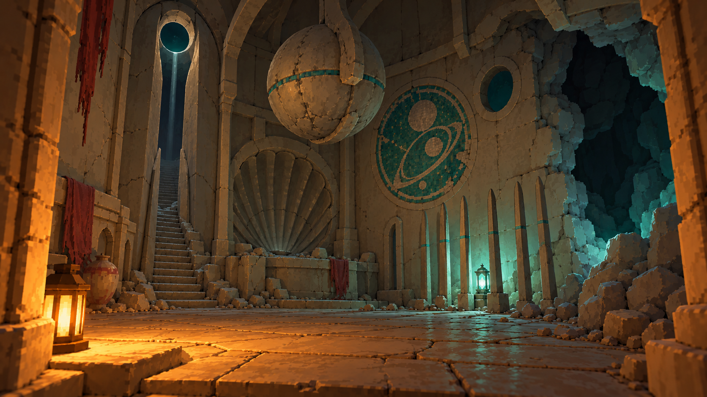
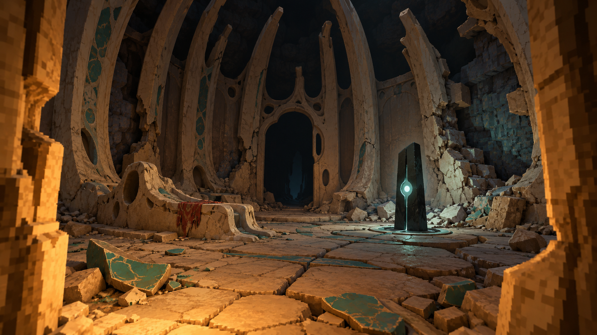

# Ancients style references

The owner approved both images on 2026-10-20 as the language of the ancients' ruins: the dungeon kit (#10089), and in time the overworld ruins. Who the ancients were is set out in the design atlas (World & Setting, "Era and fiction"):
- a fallen fusion of magic and technology, of unimaginable power and whim;
- aristocratic, vintage stylings, with discordant technology lightly present;
- found long after as weird bones, never as an Earth antiquity.

These are GPT-generated concept illustrations, not Engine screenshots. They set the vocabulary and the ruin state, not every object. The rendering method stays the [visual direction](../../visual-direction.md)'s: smooth low-poly shapes, small crisp textures at 32 texels per metre, and calm surfaces with a few strong authored details. The exact prompts are in [prompts.md](prompts.md).

## Whim: the vocabulary

Whimsical, impossible proportions:
- a doorway that is a tall narrow slot opening into a round eye;
- an overscaled scalloped shell alcove;
- a stair that rises into the vault and ends at nothing;
- a stone sphere hung from the vault on a single curving rib;
- a ceramic mosaic of an alien sky with ringed moons;
- one discordant, untouched technology element: a row of straight dark rods, with the relic light between them.

## Bones: the ruin state

The same grandeur reduced to its skeleton:
- tall curved ribs like a ribcage, several broken off;
- fallen panels showing the cave rock behind;
- heaved, cracked slabs and scattered ceramic;
- a fluid, eroded seat or plinth;
- one intact, timeless dark slab holding a cold relic light.

The kit's broken and collapsed variants take this state.

## Not this

- Greek, Roman, Egyptian, Gothic or cathedral forms, and straight medieval or elvish fantasy.
- Science-fiction panels and buried skyscrapers.
- Rejected studies (local evidence for #10089): Sanctum masonry, which read as ancient Egypt, and Sunken terraces, which were repetitive.
