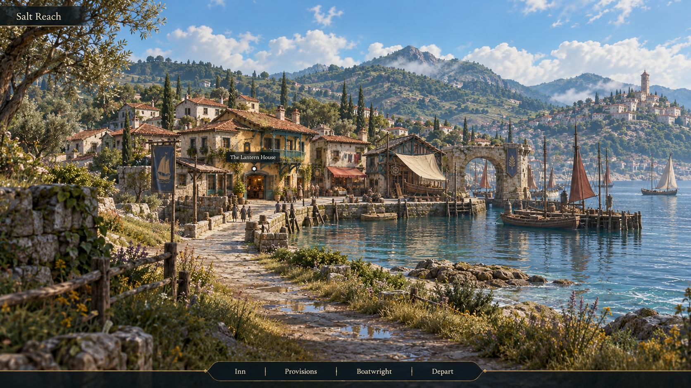
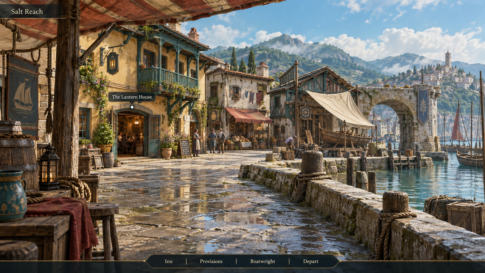
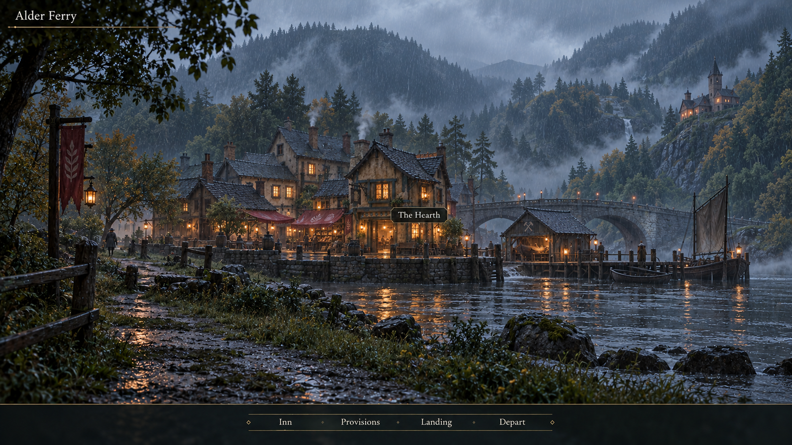
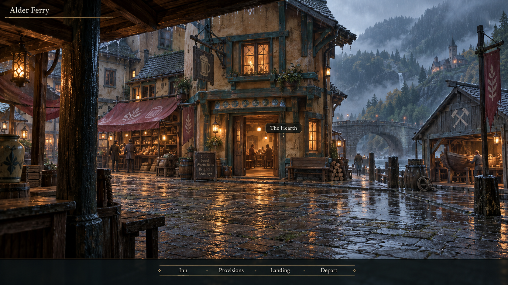
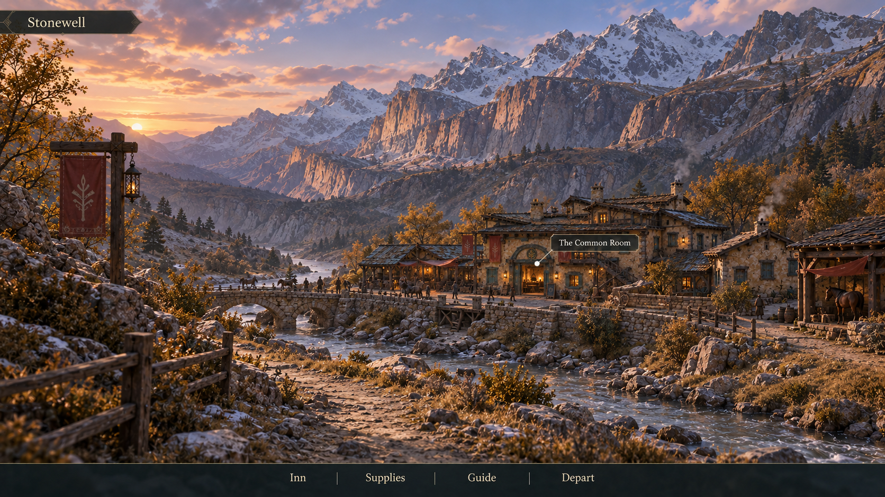
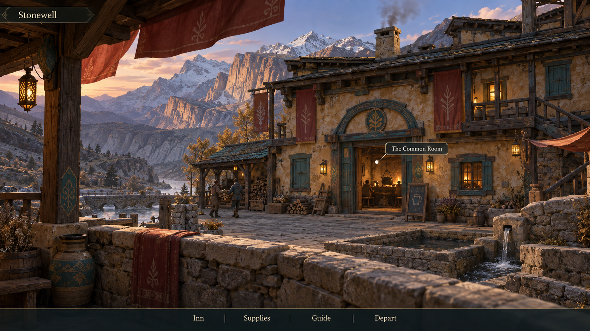
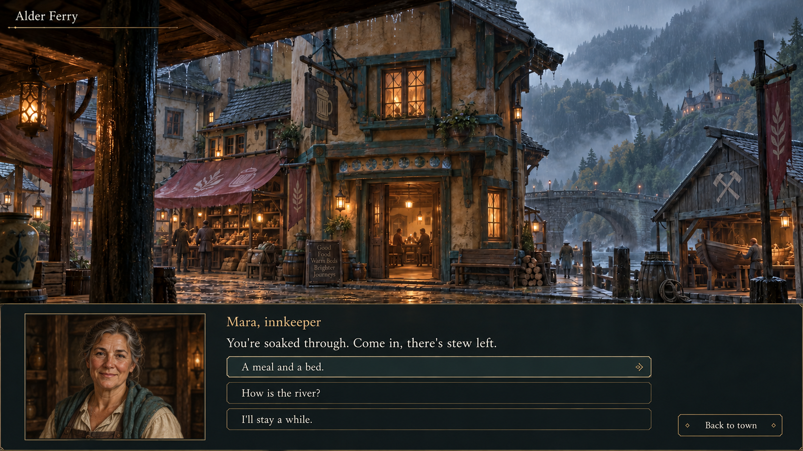
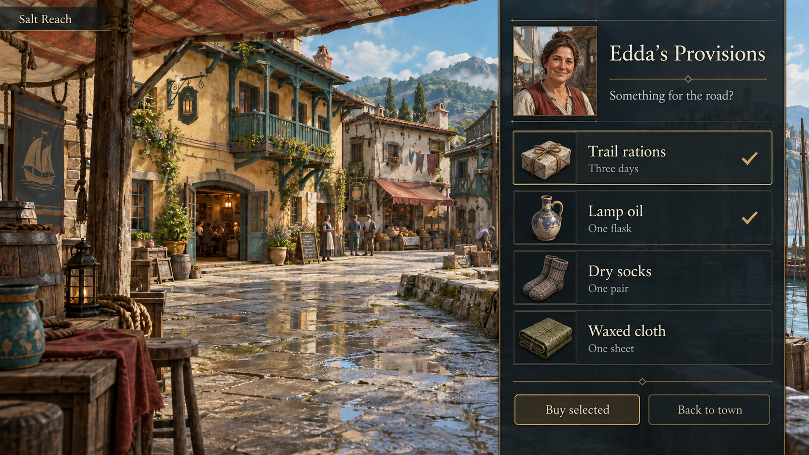

# Town mood and camera references

These eight owner-selected concept screenshots are positive references for
warm, welcoming towns in Wandering Year / CraftSurvive. They show how a small
inhabited place can provide an inviting contrast to the surrounding landscape,
and how camera distance changes the feeling of arrival.

Use them with the [visual direction](../../visual-direction.md). The evolving
design source is the [Wandering Year Design Atlas](https://github.com/FuzzySlipper/docs/blob/main/wandering-year/readme.md),
particularly [Towns, Solitude & Fellow Explorers](https://github.com/FuzzySlipper/docs/blob/main/wandering-year/pages/towns-and-explorers.md).

## Establishing and closer views

The wide views establish the settlement's geography and make shelter a visible
destination. The closer views give doorways, people and ordinary activity more
presence. Together they support testing a composed 3D town that starts with an
establishing view and moves closer when the player clicks a building, then
presents its portrait conversation or service interface. This is a camera and
presentation direction to prototype, not evidence of an implemented transition.

| Place | Establishing view | Closer view |
| --- | --- | --- |
| Salt Reach — lowland port |  |  |
| Alder Ferry — rainy upriver refuge |  |  |
| Stonewell — high-country sanctuary |  |  |

Look for sheltered entrances, inhabited windows, readable destinations, restrained
cloth and smoke, and strong foreground/middle-distance/background relationships.
The shared material family allows differences in climate and local construction
without losing the sense that these places belong to the same world.

## Portrait and service interfaces

The interface studies retain a visible town around the interaction. They explore
hospitality and easy access to practical services while keeping the scene's mood.

## Source and use

The original PNGs were generated with the built-in GPT image tool. The
[exact prompts](prompts.json) preserve each image's prompt and, for edits, a
repository-relative link to its input image. The three wide views and two
interface views were generated from the corresponding closer town views.

These are concept screenshots, not Engine captures or production assets. Their
approval concerns town mood and presentation; the names, dialogue, service
roster, architecture details and interface layout remain illustrative. The
image pairs suggest camera positions rather than proving geometrically exact
views of one modelled scene. Material detail and movement still need to be judged
in the running prototype.
